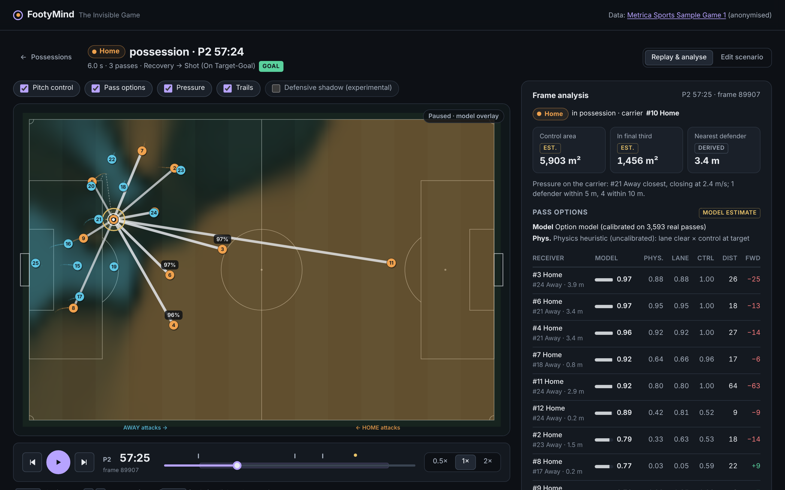
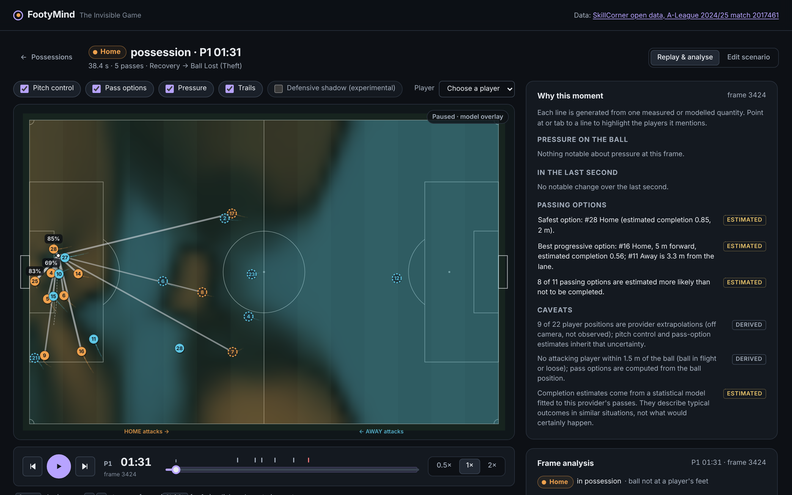

# FootyMind: The Invisible Game

**A tracking-based football analysis lab for the part of the game that statistics
miss: space, passing options, defensive influence, and "what if?" scenarios grounded in
real player positions.**

FootyMind reconstructs real possessions from synchronised player-tracking and event data
and quantifies passing options and defensive pressure with a physics-based model. It also
lets you *move a player* to see how the model's picture of the play changes. The
hypothetical is checked against physical reachability, shown side by side with the
observed state, and reported with its sensitivity to the model's assumptions.

> Status (2026-11-13): end-to-end flagship flow working on real data from two providers (23
> matches). That covers the replay, pause-and-analyse, dragging a player, comparing with
> uncertainty, and resetting. The main research result is replicated across providers. See
> [`docs/CURRENT_STATE.md`](docs/CURRENT_STATE.md).






## What is in here

| Capability | What it does | Status |
|---|---|---|
| Real tracking ingestion | Metrica Sports sample games 1–3 (CSV and EPTS) and 20 SkillCorner A-League matches (broadcast, off-camera extrapolations labelled as estimates): player and ball positions (25 Hz / 10 Hz) with synchronised events. Checksum-pinned downloads, data-quality gates, versioned bundles | ✅ |
| Spatial analytics | Pitch control (Spearman 2018 time-to-intercept model), passing-lane geometry and interception heuristic, pressure on the ball carrier | ✅ (uncalibrated estimates, labelled as such) |
| Possession Multiverse | Relocate players at a real frame → reachability check → recompute options → compare with observed → parameter-sensitivity ensemble → explicit assumptions | ✅ |
| Calibrated option model | Logistic model over per-option features incl. lead-pass targets, evaluated leave-one-match-out (v2: log loss 0.414, AUC 0.796, ECE 0.019), served as plain-JSON coefficients with bootstrap uncertainty | ✅ |
| Interactive lab (web) | Canvas replay at 60 fps, overlays, drag-to-edit scenarios, observed/hypothetical/difference views, evidence panel | ✅ |
| Research: does spatial context matter? | Leakage-audited attempted-pass outcome study with event-only, spatial and interaction model families, ablations and sensitivity analyses | ✅ v1 |
| Ghost Value: Defensive Shadow | Per-defender suppression of passing value against nearby alternative positions | 🧪 experimental (API + UI layer; partly validated, see findings) |

## Key research findings

On held-out matches (leave-one-match-out), two questions are kept separate after an
independent methodology review. The primary result is replicated across two providers:
Metrica (3 matches, optical, 25 Hz) and SkillCorner (20 A-League matches, broadcast, 10 Hz).

* **Before the pass is played** (decision-time, nothing from the kick): adding tracking-derived
  spatial context reduces log loss by **Δ −0.026 [−0.034, −0.018]** on Metrica (AUC 0.65 → 0.72)
  and by **Δ −0.021 [−0.025, −0.018]** on SkillCorner (15,914 passes). The gain holds in every
  held-out match of both providers (3/3 and 20/20).
* **Given the executed kick** (action-conditioned: release direction and speed known):
  Δ −0.071 on Metrica and −0.046 on SkillCorner. This is provider-dependent, because much of it
  is where the ball was actually played relative to teammates, which is partly execution quality.
* **Defender-only** information adds a small but consistent improvement (Δ −0.015 / −0.018).
  Interaction features add nothing on 3 matches and a small, significant amount (−0.004) on 20.
* **Negative results:** the literature physics model is poorly calibrated (ECE 0.17), and
  fitting its parameters drives them to implausible bounds, so it is structurally
  misspecified. The experimental *Defensive Shadow* metric is robust to tracking noise and
  finds interceptors at 2× chance on Metrica, but it is **not** better than "nearest defender", and
  on SkillCorner it is at chance (the 2× signal does not replicate).


These results are consistent with established findings (Power et al. 2017; Anzer & Bauer 2022)
on open data, with an explicit leakage audit and a cross-provider replication. They are not a
new discovery, and two leagues' worth of samples cannot support universal claims. See [`docs/RESEARCH.md`](docs/RESEARCH.md)
and the [claims ledger](docs/CLAIMS_LEDGER.md).

## Scientific guardrails

* **Provenance on everything.** Each value is *observed*, *derived*, *estimated*,
  *hypothetical* or *simulated*, and the API and UI keep these distinct.
* **No fabricated observations.** Unobserved positions are `null`. Tracking artefacts are
  flagged, not smoothed away. Broadcast positions that the provider extrapolated off camera are
  labelled *estimated* and drawn hollow, never presented as observed.
* **Providers are never pooled.** Metrica and SkillCorner differ in frame rate, visibility and
  labels, so each is evaluated separately and has its own option model.
* **No leakage.** Decision-time features use causal velocities only. Failed-pass end
  locations, which are the *loss location* in Metrica, are excluded.
* **Counterfactuals are not causal claims.** Scenarios are model-based comparisons with
  feasibility checks, stated assumptions and a parameter ensemble showing whether the
  direction of change is robust.

## Quick start

```bash
uv sync
uv run footymind download      # Metrica sample games, SHA-256 verified (~180 MB)
uv run footymind ingest        # build processed bundles (~3 s per match)
uv run pytest -q               # unit + real-data tests
uv run footymind serve         # API at http://127.0.0.1:8000 (docs at /docs)
```

Run the web lab (in a second terminal, with the API running):

```bash
cd web && npm ci && npm run dev    # http://localhost:5173 (proxies /api to :8000)
```

Or build it once (`cd web && npm run build`) and `footymind serve` will serve it at `/`.
Backend and frontend checks are listed in [`CLAUDE.md`](CLAUDE.md) and [`web/README.md`](web/README.md).

Or run everything in one container (the first start downloads and ingests the data):

```bash
docker build -t footymind .
docker run --rm -p 8000:8000 -v footymind-data:/data footymind   # http://localhost:8000
```

Reproduce the research results:

```bash
uv run footymind experiment experiments/configs/pass_outcome_v1.json
uv run footymind experiment experiments/configs/pass_outcome_v1_ablation.json
```

Try a counterfactual through the API:

```bash
curl -s -X POST http://127.0.0.1:8000/api/scenarios -H 'content-type: application/json' \
  -d '{"match_id":"metrica-sample-1","frame":20666,"interventions":[{"player_id":"home_2","x":-3.0,"y":-20.0}]}'
```

## Architecture

A modular monolith: a Python package (`footymind`) with provider adapters → canonical
tracking model → spatial models → counterfactual engine and research pipeline, served by
FastAPI. The frontend is Vite + React + TypeScript with a Canvas pitch renderer. See
[`docs/ARCHITECTURE.md`](docs/ARCHITECTURE.md) and the [ADRs](docs/adr/).

## Data and attribution

Tracking and event data: **Metrica Sports sample data**
(https://github.com/metrica-sports/sample-data), which is anonymised, and **SkillCorner open
data** (https://github.com/SkillCorner/opendata, MIT; credit SkillCorner). Raw data is
downloaded at setup and is not redistributed in this repository. See
[`docs/DATA_SOURCES.md`](docs/DATA_SOURCES.md).

## History

FootyMind v1, a match-outcome predictor trained on a small synthetic sample, is archived
with an audit of its limitations in [`legacy/match_outcome_predictor`](legacy/match_outcome_predictor).
