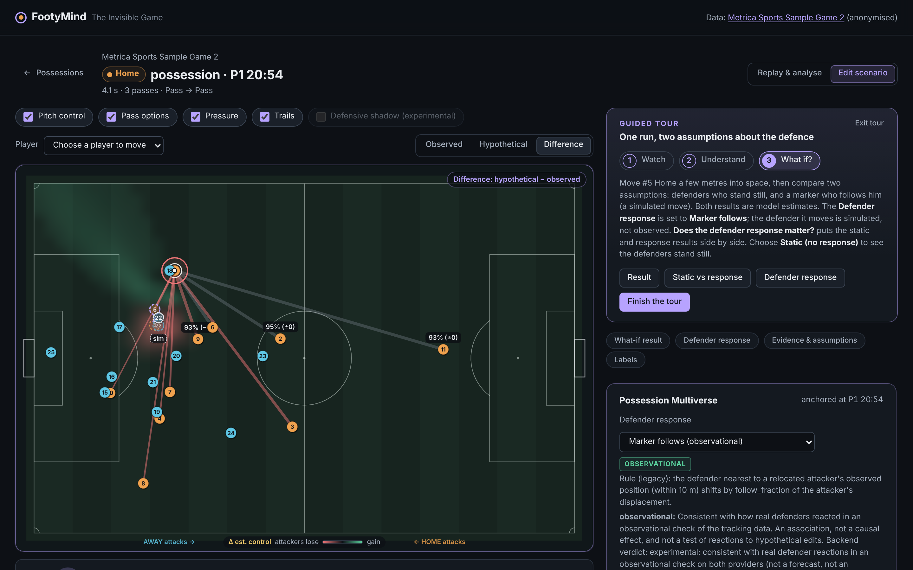
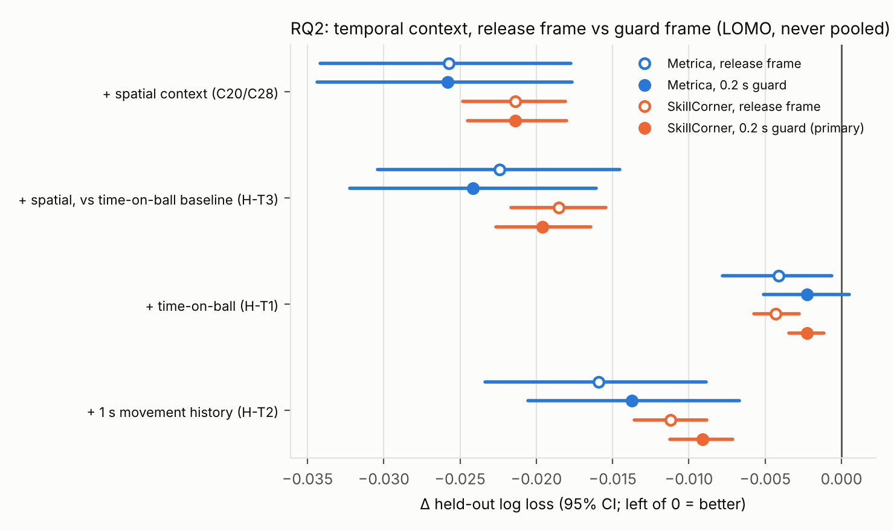
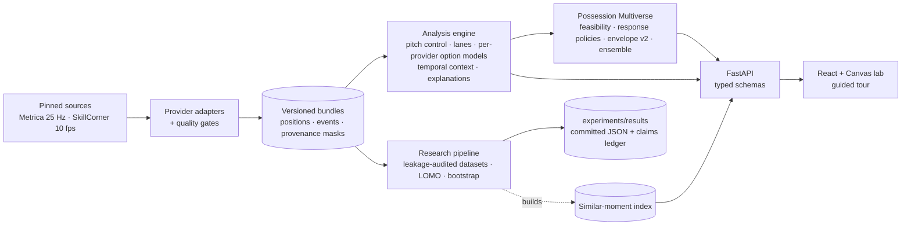

# FootyMind: The Invisible Game

**A tracking-based football analysis lab for the part of the game that statistics
miss: space, passing options, defensive influence, and "what if?" scenarios grounded in
real player positions.**

Event data records what happened to the ball. FootyMind reconstructs what the event log cannot
see: the space, the pressure and the passing options behind each decision. It works from real
player-tracking data from two providers, 3 Metrica matches (optical, 25 Hz) and 20 SkillCorner
A-League matches (broadcast, 10 fps). In the web lab you can:
* replay a possession;
* pause on a decision and read why it was interesting, from computed evidence;
* find similar moments from other matches;
* move a player and see how the model's picture changes under explicit, partly validated
  assumptions about how the defence would respond.

Behind the lab is a research pipeline with pre-registered, leakage-audited, leave-one-match-out
experiments. Every number quoted here is traced in a [claims ledger](docs/CLAIMS_LEDGER.md) to a
committed result.

> **Status: 1.0 release candidate (2026-11-14).** All five pillars run end to end on real data:
> data engineering, analysis engine, Possession Multiverse, web lab, and a reproducible research
> release. The container is verified at runtime. Read the
> [technical research report](docs/RESEARCH_REPORT.md), the [model cards](docs/MODEL_CARDS.md)
> and [`docs/CURRENT_STATE.md`](docs/CURRENT_STATE.md).





## What is distinctive

* **Honesty is part of the product.**
  * Every value carries a provenance label (observed, derived, estimated, hypothetical,
    simulated) in the API and the UI.
  * Unobserved data stays empty instead of being filled in.
  * Experimental models are labelled as such, and negative results are reported next to
    positive ones.
* **Leakage control beyond "no future frames".**
  * On broadcast tracking the event frame often already contains the kick, in 62.7% of passes.
    Decision-time features are therefore read 0.2 s earlier, a guard frame chosen after a pilot
    and then checked against the pre-kick floor
    guard frame (C38, ADR-0007).
  * Frame-rate unit bugs between 25 Hz and 10 fps were found and fixed: the shadow recovery
    window and the event-carrier tolerance. Two short frame-count rules in the pass dataset
    (a 2-frame restart window and a 2-frame minimum duration) remain and are documented.
* **Two providers, never pooled.** Every experiment is replicated separately on optical and
  broadcast tracking.
* **Counterfactuals with stated, tested assumptions.**
  * Opponent-response rules are checked against how real defenders react to unexpected
    attacker movement, with a placebo design.
  * The UI says which rules pass that check, and that no rule is a causal model.

## What is in here

| Capability | What it does | Status |
|---|---|---|
| Real tracking ingestion | Metrica Sports sample games 1–3 (CSV and EPTS) and 20 SkillCorner A-League matches (broadcast, off-camera extrapolations labelled as estimates): player and ball positions (25 Hz / 10 Hz) with synchronised events. Checksum-pinned downloads, data-quality gates, versioned bundles | ✅ |
| Spatial analytics | Pitch control (Spearman 2018 time-to-intercept model), passing-lane geometry and interception heuristic, pressure on the ball carrier | ✅ (uncalibrated estimates, labelled as such) |
| Possession Multiverse | Relocate players at a real frame → reachability check → recompute options → compare with observed → parameter-sensitivity ensemble → explicit assumptions | ✅ |
| Calibrated option model | Logistic model over per-option features incl. lead-pass targets, evaluated leave-one-match-out (v2: log loss 0.414, AUC 0.796, ECE 0.019), served as plain-JSON coefficients with bootstrap uncertainty | ✅ |
| Interactive lab (web) | Guided first-visit tour over three featured real situations, Canvas replay at 60 fps, overlays, keyboard- and drag-based scenario editing, observed/hypothetical/difference views, evidence panel; responsive and axe-checked | ✅ |
| Research: does spatial context matter? | Leakage-audited attempted-pass outcome study with event-only, spatial and interaction model families, ablations and sensitivity analyses | ✅ v1 |
| Ghost Value: Defensive Shadow | Per-defender suppression of passing value against nearby alternative positions | 🧪 experimental (API + UI layer; not better than nearest-defender, at chance on SkillCorner) |
| Opponent response policies | Defender reactions to a scenario edit (`marker_follows`, `lane_cover`, `press_carrier`, `zonal_shift`, `learned`, `learned_innovation`) limited by a pre-registered kinematic envelope v2, with a static-vs-response comparison in the lab | `learned`: validated forecaster of real play, nearly inert under edits. `learned_innovation`: observational co-movement model (needs attackers' real movement; user edits extrapolate). Rules: 🧪 experimental, each with its observational-check result |
| Temporal context | Causal time-on-ball and last-second movement history at a guard frame before the release (ADR-0007), served with the frame analysis | ✅ research study RQ2 (see findings) |
| Why this moment | Deterministic, evidence-grounded statements: each sentence is tied to one computed metric, its provenance and the players it mentions | ✅ |
| Similar moments | The most similar pass decisions from *other* matches of the same provider, with observed outcomes and deep links | ✅ validated held-out (beats the base rate on both providers) |

## Key research findings

On held-out matches (leave-one-match-out), two questions are kept separate after an
independent methodology review. The primary result is replicated across two providers:
Metrica (3 matches, optical, 25 Hz) and SkillCorner (20 A-League matches, broadcast, 10 Hz).

* **Before the pass is played** (decision-time: no release direction or speed): adding tracking-derived
  spatial context reduces log loss by **Δ −0.026 [−0.034, −0.018]** on Metrica (AUC 0.65 → 0.72)
  and by **Δ −0.021 [−0.025, −0.018]** on SkillCorner (15,914 passes; with matches resampled too,
  and every feature read 0.2 s before the kick: −0.021 [−0.026, −0.017], C35). The gain holds in every
  held-out match of both providers (3/3 and 20/20).
* **Given the executed kick** (action-conditioned: release direction and speed known):
  Δ −0.071 on Metrica and −0.046 on SkillCorner. This is provider-dependent, because much of it
  is where the ball was actually played relative to teammates, which is partly execution quality.
* **Defender-only** information (action-conditioned comparison) adds a small but consistent
  improvement (Δ −0.014 / −0.018; C12, C28).
  Interaction features add nothing on 3 matches and a small, significant amount (−0.004) on 20.
* **Negative results:** the literature physics model is poorly calibrated (ECE 0.18, C7), and
  fitting its parameters drives them to implausible bounds, so it is structurally
  misspecified. The experimental *Defensive Shadow* metric is robust to tracking noise and
  finds interceptors at 2× chance on Metrica, but it is **not** better than "nearest defender", and
  on SkillCorner it is at chance (the 2× signal does not replicate).
* **The last second matters (session 3, RQ2).** Adding 1 s of movement history (pressure
  building, ball travel, team and defensive-line movement) to decision-time spatial context
  improves held-out prediction on both providers: **Δ −0.014** on Metrica and **Δ −0.009** on
  SkillCorner, better in 20/20 matches. Every feature is read **0.2 s before the release**,
  because on broadcast tracking the event frame often already contains the kick (ADR-0007).
  The headline spatial result above is unchanged under that guard (C33–C35, C38).
* **Off-ball credit is convention-dependent.** In the second before a pass, attacking movement
  raises the best progressive option and defensive movement takes about as much back, on
  average. The option model is so non-additive that per-pass credit for a run depends on
  which side is held fixed. A placebo shows this is mostly the model, with a small
  genuine attacker–defender coupling on both providers (C31, C32). Putting back the defenders'
  reactions to a run changes its average credit by at most 0.0003, even with a fitted response that
  moves the whole block; what decides the credit is where defenders are assumed to have been
  otherwise (C45–C49).
* **Opponent responses.** A learned position model forecasts real defender movement better than
  constant velocity but is inert under edits. Positions barely predict how defenders deviate
  from their own motion (C61). A model of *co-movement* with attackers' unexpected movement
  beats constant velocity and a placebo on both providers and is served as an observational
  response (C62). Of the interpretable rules, `marker_follows` and `lane_cover` beat constant
  velocity and size-matched placebos at forecasting how real defenders react to unexpected
  attacker movement, on both providers. `press_carrier` and `zonal_shift` do not (C70).
* **Similar moments are informative.** The completion rate among the 50 most similar decisions
  from other matches beats the base rate held-out on both providers (−0.057 / −0.051 log loss)
  and matches the logistic model on SkillCorner (C36).




These results are consistent with established findings (Power et al. 2017; Anzer & Bauer 2022)
on open data, with an explicit leakage audit and a cross-provider replication. They are not a
new discovery, and two leagues' worth of samples cannot support universal claims. See [`docs/RESEARCH.md`](docs/RESEARCH.md)
and the [claims ledger](docs/CLAIMS_LEDGER.md).

## Scientific guardrails

* **Provenance on everything.** Each value is *observed*, *derived*, *estimated*,
  *hypothetical* or *simulated*, and the API and UI keep these distinct.
* **No fabricated observations.** Unobserved positions are `null`. Tracking artefacts are
  flagged, not smoothed away. Broadcast positions that the provider extrapolated off camera are
  labelled *estimated* and drawn hollow, never presented as observed.
* **Providers are never pooled.** Metrica and SkillCorner differ in frame rate, visibility and
  labels, so each is evaluated separately and has its own option model.
* **No leakage.** Decision-time features use causal velocities only. Failed-pass end
  locations, which are the *loss location* in Metrica, are excluded.
* **Counterfactuals are not causal claims.** Scenarios are model-based comparisons with
  feasibility checks, stated assumptions and a parameter ensemble showing whether the
  direction of change is robust.

## Quick start

```bash
uv sync
# Metrica sample games, SHA-256 verified (~180 MB), then processed bundles (~3 s per match)
uv run footymind download metrica-sample-1 metrica-sample-2 metrica-sample-3
uv run footymind ingest metrica-sample-1 metrica-sample-2 metrica-sample-3
uv run footymind build-similarity-index --provider metrica   # "Similar moments" index (~40 s)
uv run pytest -q             # unit + real-data tests
uv run footymind serve       # API at http://127.0.0.1:8000 (docs at /docs)
```

Without match ids, `download` and `ingest` take **every** registered source, including the
20 SkillCorner matches (about 1.8 GB more). Data lives in `./data` unless `FOOTYMIND_DATA_DIR`
points elsewhere. Without the similarity index the API answers `/similar` with a 503 and the
lab shows a "no index" note.

Run the web lab (in a second terminal, with the API running):

```bash
cd web && npm ci && npm run dev    # http://localhost:5173 (proxies /api to :8000)
```

Or build it once (`cd web && npm run build`) and `footymind serve` will serve it at `/`.
Backend and frontend checks are listed in [`CLAUDE.md`](CLAUDE.md) and [`web/README.md`](web/README.md).

Or run everything in one container (the first start downloads and ingests the three Metrica
games and builds the similarity index, about a minute; set `FOOTYMIND_SOURCES` to choose
other sources). On later starts it re-ingests bundles from an older pipeline version, adds
missing `FOOTYMIND_SOURCES` and rebuilds a stale index; a running server picks up a re-ingest or
an index rebuild without a restart:

```bash
docker build -t footymind .
docker run --rm -p 8000:8000 -v footymind-data:/data footymind   # http://localhost:8000
scripts/container_smoke.sh   # build, run on a copy of local data and check it end to end
```

`scripts/container_smoke.sh` seeds the container from your local `data/processed`. By default it
mounts the three Metrica bundles **and** three SkillCorner bundles (1874553, 1899585, 2017461)
and finishes with the Playwright flow, so it needs those SkillCorner bundles and Playwright
(`cd web && npm ci && npx playwright install chromium`). For a Metrica-only check run
`SMOKE_MATCHES="metrica-sample-1 metrica-sample-2 metrica-sample-3" scripts/container_smoke.sh --no-e2e`
(other flags: `--no-build`, `--keep`; see the script header).

Reproduce the research results:

```bash
uv run footymind experiment experiments/configs/pass_outcome_v1.json
uv run footymind experiment experiments/configs/pass_outcome_v1_ablation.json
```

Try a counterfactual through the API:

```bash
curl -s -X POST http://127.0.0.1:8000/api/scenarios -H 'content-type: application/json' \
  -d '{"match_id":"metrica-sample-1","frame":20666,"interventions":[{"player_id":"home_2","x":-3.0,"y":-20.0}]}'
```

## Architecture



A modular monolith: one Python package and one FastAPI process, which can also serve the
built frontend. There is no database or queue (ADR-0001). See
[`docs/ARCHITECTURE.md`](docs/ARCHITECTURE.md) and the [ADRs](docs/adr/).

**Technology.**
* Backend: Python 3.13, uv, NumPy, Polars, SciPy, scikit-learn, FastAPI and pydantic.
* Frontend: TypeScript, React, Vite, Canvas 2D, Vitest and Playwright.
* Quality and delivery: ruff, mypy, Docker, and GitHub Actions (lint, types, unit, real-data,
  web and container-runtime jobs).

## Testing and verification

```bash
scripts/check.sh                                   # every CI gate: ruff, format, mypy, pytest; web typecheck, lint, vitest, build
cd web && npx playwright test --trace off          # end-to-end journeys against the real API (needs processed data)
scripts/container_smoke.sh                         # build the image, run it, check the API and the lab end to end
scripts/reproduce.sh --dry-run                     # every committed research artefact, in dependency order
```

The latest verified counts and CI status are in [`docs/CURRENT_STATE.md`](docs/CURRENT_STATE.md).
[`docs/release/VERIFICATION.md`](docs/release/VERIFICATION.md) records the clean-setup and
container checks.

## Limitations

* **Small, specific samples.** 3 anonymised Metrica matches and 20 matches from one A-League
  season. Results are not claims about football in general.
* **Observational data.** Pass-outcome results are associations between pre-decision context
  and outcomes of passes players chose to make. Estimates for options nobody chose are
  extrapolations.
* **Broadcast tracking.** About a third of SkillCorner positions are provider extrapolations,
  labelled *estimated*, and the event frames lag the kick (C30, C38).
* **Counterfactuals are model-based.** No response policy is validated as a response to an
  intervention that never happened. The best of them are consistent with how real defenders
  react to real movement (C62, C64).
* **Negative results.** Physics pass probabilities, the Defensive Shadow metric and simple
  off-ball run value did not survive evaluation. They are kept, and labelled, as experimental
  or explanatory tools. See the [research report](docs/RESEARCH_REPORT.md).

## Data and attribution

Tracking and event data: **Metrica Sports sample data**
(https://github.com/metrica-sports/sample-data), which is anonymised, and **SkillCorner open
data** (https://github.com/SkillCorner/opendata, MIT; credit SkillCorner). Raw data is
downloaded at setup and is not redistributed in this repository. See
[`docs/DATA_SOURCES.md`](docs/DATA_SOURCES.md).

## History

FootyMind v1, a match-outcome predictor trained on a small synthetic sample, is archived
with an audit of its limitations in [`legacy/match_outcome_predictor`](legacy/match_outcome_predictor).
