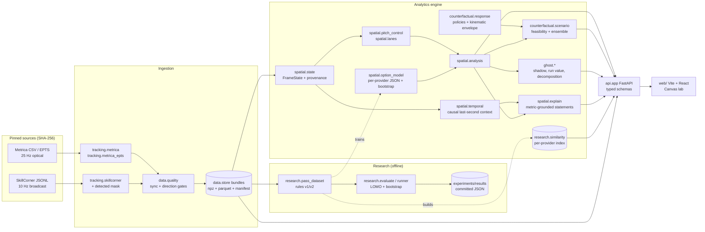

# Architecture

FootyMind is a **modular monolith**: one Python package (`footymind`) behind one
FastAPI process, plus a static TypeScript frontend (`web/`) that the same process can
serve. There is no database server, cache, queue or microservice. ADR-0001 explains why.

## Modules

| Module | Responsibility | Status |
|---|---|---|
| `data.sources` | Registry of remote files with pinned SHA-256; verified downloader | done (Metrica 1–3 registered) |
| `tracking.model` | `TrackingData`, `PlayerInfo`, `PitchSpec`, `Provenance` | done |
| `tracking.coords` | Provider ↔ canonical transforms; attacking-frame rotation | done |
| `tracking.metrica`, `tracking.metrica_epts` | Metrica CSV (games 1–2) and EPTS/JSON (game 3) adapters | done |
| `tracking.skillcorner` | SkillCorner broadcast adapter (10 fps; `detected` mask; dynamic-event pass mapping) | done |
| `tracking.kinematics` | causal / centred velocity; implausible-motion flags | done |
| `tracking.possessions` | event-based possession segmentation | done (v1 rules) |
| `data.quality` | quality report and ingestion gates (sync, ids, frames) | done |
| `data.store` | versioned processed bundles (npz + parquet + manifest) | done |
| `spatial.state` | `FrameState` at a frame: velocities, GK, possession team, carrier | done |
| `spatial.pitch_control` | PPCF time-to-intercept model (Spearman 2018) | done, uncalibrated |
| `spatial.lanes` | lane geometry + heuristic interception | done, uncalibrated |
| `spatial.option_features`, `spatial.option_model` | shared per-option features (incl. lead-pass targets); per-provider JSON option models with bootstrap members; never pooled | done (v2) |
| `spatial.analysis` | frame analysis: control grid, pass options (physics + option model), pressure | done |
| `spatial.temporal` | causal temporal context (time-on-ball, censored; 1 s movement history) at a decision frame; guard-frame aware (ADR-0007) | done |
| `spatial.explain` | deterministic, metric-grounded explanation statements with provenance | done |
| `research.similarity` | per-provider similar-moment index (guard-frame features), own match excluded; validated k = 50 shrunk estimate (C36) | done |
| `ghost.movement_decomposition` | Shapley attack/defense decomposition of opportunity change (with rotation placebo in the study) | research |
| `counterfactual.scenario` | constrained interventions, final-state feasibility (user + simulated moves), response policy plumbing, uncertainty ensemble | done |
| `counterfactual.kinematics` / `.response` / `.response_model` | reachability envelopes; defender response policies (rules + learned ridge, differential and envelope-clipped; ADR-0006); per-provider JSON coefficients | done (rules experimental; learned validated as a forecaster only) |
| `ghost.defensive_shadow`, `ghost.run_value` | experimental model-based sensitivities (partly / negatively validated) | experimental |
| `research.*` | pass-outcome dataset (rules v1/v2), decision-time and action-conditioned families, LOMO evaluation, physics calibration, shadow/run-value validation, figures, failure modes | done |
| `api.app`, `api.schemas` | HTTP contract | done |
| `web/` | replay, analysis, scenario editing, deep links, Defensive Shadow layer, broadcast provenance styling | done |

## Coordinates

* Canonical frame `canonical-v1`: metres, origin at the centre spot, `x ∈ [-L/2, L/2]`
  along the length, `y ∈ [-W/2, W/2]` across the width, **y up** (right-handed).
* Orientation is the **provider's**. Teams swap ends at half-time, and coordinates are
  not flipped. `TrackingData.home_attacks_positive_x[period]` records the direction,
  inferred from goalkeeper positions: the deepest median x per team per period. If
  the two goalkeepers do not sit in opposite halves, ingestion fails rather than guessing.
* `to_attacking_frame(xy, sign)` rotates by 180° (x→−x, y→−y). This is a rotation, not
  a reflection, so a team's left wing stays on its left.
* Metrica: `(0,0)` is the top-left corner and `(1,1)` the bottom-right. The conversion is
  `x = (u − 0.5)·105`, `y = −(v − 0.5)·68`. Tests pin the landmarks and a known raw value
  from Game 1, frame 1.
* Frontend canvas: `y_canvas = (W/2 − y)·scale`.

## Time and synchronisation

* Metrica tracking is 25 Hz, with contiguous frame ids across both periods and a cumulative
  `Time [s]`. Event `Start/End Frame` values are tracking frame ids. `End Frame = 0`
  means no end and is stored as null.
* Ingestion **fails** if the median passer-to-ball distance at pass start frames exceeds
  1.5 m. Measured: 0.084 m (game 1) and 0.088 m (game 2).

## Observation semantics and provenance

`Provenance` ∈ {observed, derived, estimated, hypothetical, simulated} is carried on
every analytical field in the API and must be shown in the UI.

| Label | Meaning | Examples |
|---|---|---|
| observed | provider measurement after fixed unit conversion | positions, ball (detected) |
| derived | deterministic function of observations | causal velocity, lane distances, pressure |
| estimated | model output with assumptions/parameters, **or a provider extrapolation** | pitch control, p_success, off-camera broadcast positions |
| hypothetical | user-specified intervention | a relocated defender |
| simulated | produced by a response policy | marker following a moved attacker |

Unobserved positions are `NaN` in arrays and `null` in JSON. They are never interpolated
silently. Tracking artefacts (single-frame steps faster than 12 m/s) are flagged, and the
derived velocities at those frames are NaN.

## Leakage rules for decision-time features

1. Use positions at the decision frame only.
2. Use velocities from the **causal** estimator only. The centred Savitzky–Golay filter
   reads future frames; `test_centered_velocity_reads_future` documents this.
3. Action descriptors (release direction/speed) are measured within ≤ 0.12 s after the
   start frame, truncated before the outcome frame.
4. Never use event end locations, durations, receiver ids or outcome-encoding subtypes.

## API

Contract: `src/footymind/api/schemas.py`. Interactive docs: `GET /docs` when serving.

| Method | Path | Purpose |
|---|---|---|
| GET | `/api/health` | liveness + available matches |
| GET | `/api/matches`, `/api/matches/{id}` | match metadata, source attribution |
| GET | `/api/matches/{id}/possessions?min_passes&team` | possession list |
| GET | `/api/matches/{id}/replay?start_frame&end_frame&step` | observed tracking window (≤ 4000 frames) |
| GET | `/api/possessions/{pid}/replay?pad_s&step` | replay for one possession |
| GET | `/api/matches/{id}/frames/{frame}/analysis?grid` | pitch control, pass options, pressure, causal temporal context, explanations |
| GET | `/api/matches/{id}/frames/{frame}/possession` | resolves a stable `#/at/<match>?f=` deep link to its possession |
| GET | `/api/matches/{id}/frames/{frame}/similar?k` | similar past decisions (other matches, same provider), observed outcomes, validated estimate |
| POST | `/api/scenarios` | constrained intervention + comparison + sensitivity |
| GET | `/api/response-policies?match_id=` | response policies with description, assumptions and provider-specific `validated` |

Measured latency (local, 4 vCPU): replay of a 356-frame possession is 29 ms / 122 KB before
gzip. Frame analysis takes about 70 ms warm and about 0.3 s cold, because the first call
computes velocities for the match. A scenario with a 24-member ensemble takes about 0.3 s.

## Storage

`data/raw/<provider>/` holds verified downloads. `data/processed/<match_id>/` holds:
`tracking.npz` (about 24 MB per match), `players.parquet`, `events.parquet`,
`possessions.parquet` and `manifest.json`. The manifest records the pipeline version, the
code revision, source hashes, coordinate system and quality report. Loaders reject bundles
built by a different `PIPELINE_VERSION`. Neither directory is committed.
