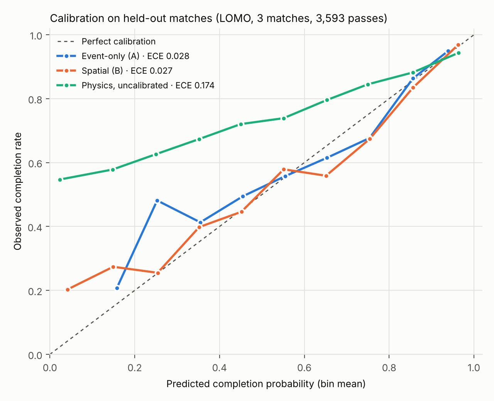
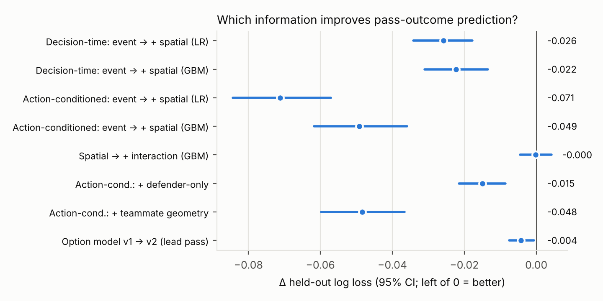
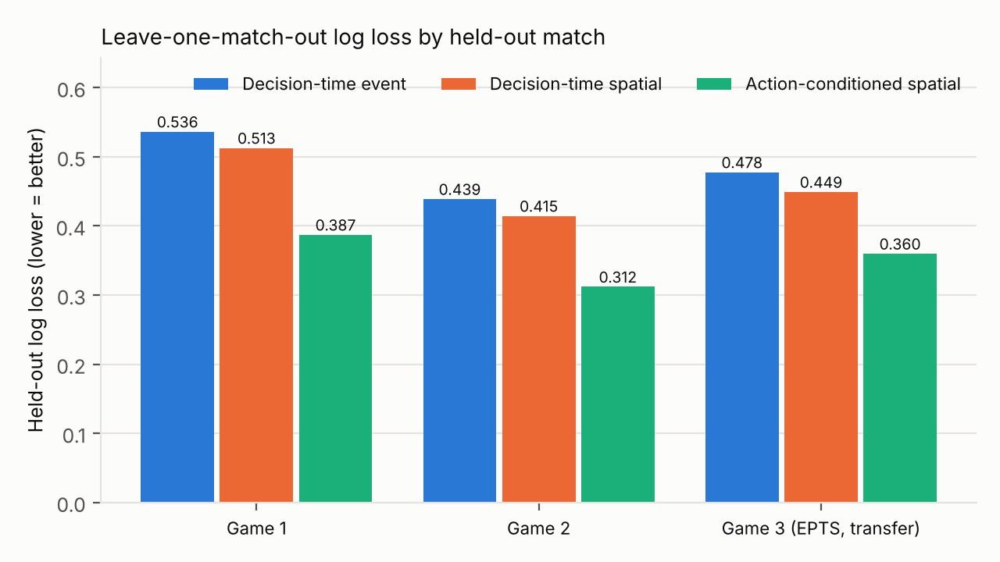

# Research log

Living record of research questions, experiment designs, results (including negative
ones) and prior art. Quotable numbers must also appear in `CLAIMS_LEDGER.md`.

## RQ1 headline (v3, after independent review): two different questions

An independent methodology review (2026-11-13) found **no hard label leakage**. It did find
that the v1/v2 "spatial" models are **action-conditioned**: their strongest feature, the
alignment of the *executed* release direction with a teammate, uses information from the
kick itself. Both questions are legitimate, but they must not be conflated:

* **Decision-time:** before the pass is played, does spatial context improve the prediction
  of whether the possessor's next pass is completed? Nothing derived from the kick is used.
* **Action-conditioned:** given the executed release direction and speed, does spatial
  context improve the prediction?

`experiments/results/pass_outcome_v3` (rules v2, 3 matches, 3,593 attempted passes, LOMO,
code 2131084):

| question | baseline → spatial (LR) | Δ log loss [95% CI] | AUC |
|---|---|---|---|
| decision-time | 0.482 → 0.456 | **−0.026 [−0.034, −0.018]** | 0.648 → 0.721 |
| decision-time (GBM) | 0.476 → 0.454 | −0.022 [−0.031, −0.014] | 0.683 → 0.728 |
| action-conditioned | 0.423 → 0.352 | **−0.071 [−0.084, −0.057]** | 0.785 → 0.869 |
| action-conditioned (GBM) | 0.400 → 0.351 | −0.049 [−0.062, −0.036] | 0.814 → 0.866 |
| the kick itself (decision-time event → action-conditioned event) | 0.482 → 0.423 | −0.059 [−0.070, −0.047] | 0.648 → 0.785 |
| interaction features (B GBM → C GBM) | 0.351 → 0.351 | −0.000 [−0.005, +0.004] | — |
| action-cond.: + defender-only | 0.423 → 0.408 | −0.015 [−0.022, −0.009] | — |

Per held-out match (decision-time LR): 0.536 → 0.513, 0.439 → 0.415, 0.478 → 0.449. The gain
holds in every fold.

**Reading.** Spatial context measurably improves prediction even before the kick. The effect
is about a third of the action-conditioned gain. Most of the action-conditioned gain comes
from combining *where the ball was actually played* with *where teammates are*, which is
partly execution quality. Defender-only information adds a small but consistent signal.
Interaction features add nothing.

**Rules v2 (review fixes; v1 configs are pinned and still reproduce exactly):**
* symmetric subtype allow-list for successes and failures (no clearances or offsides on either side);
* history from strictly earlier frames, with the restart flag taken from the last set piece;
* attempts resolved in under 2 frames are dropped, because the release window would touch the outcome (16 rows);
* release speeds above 40 m/s are dropped as tracking artefacts.

**Failure modes (v3, action-conditioned A vs B LR,
`experiments/results/pass_outcome_v3/failure_modes.json`).** The largest gain is on releases
more than 20° from any teammate: −0.189 [−0.250, −0.131], n = 588. Gains are also robust in
the final third (−0.110), under pressure (−0.087) and on forward passes (−0.086). Headers
show no reliable gain (−0.027 [−0.142, +0.093], n = 144).

### Cross-provider replication: SkillCorner broadcast tracking (`pass_outcome_skillcorner_v1`, code cf54026)

Same rules (v2), feature definitions, model families and protocol, run on a **different
provider, competition and technology**: SkillCorner open data, A-League 2024/25, 20 matches,
broadcast tracking at 10 fps, with off-camera players extrapolated by the provider. There
are 15,867 attempted passes (84.1% completed), using LOMO over 20 matches with a
possession-clustered bootstrap (1,000). The two providers are evaluated separately and never
pooled. The receiver inference reaches 72.4% top-1.

| effect | Metrica v3 (3 matches, 3,593) | SkillCorner (20 matches, 15,867) |
|---|---|---|
| **decision-time**: event → + spatial (LR) | −0.026 [−0.034, −0.018] | **−0.024 [−0.027, −0.020]**, better in 20/20 matches |
| decision-time (GBM) | −0.022 [−0.031, −0.014] | −0.023 [−0.026, −0.019] |
| action-conditioned: event → + spatial (LR) | −0.071 [−0.084, −0.057] | −0.044 [−0.049, −0.040], 20/20 matches |
| + defender-only (action-cond.) | −0.015 [−0.022, −0.009] | −0.017 [−0.020, −0.014] |
| + teammate geometry (action-cond.) | −0.048 [−0.060, −0.037] | −0.012 [−0.015, −0.009] |
| interaction features (B GBM → C GBM) | −0.000 [−0.005, +0.004] | **−0.004 [−0.006, −0.003]**, 15/20 matches |
| option model v1 → v2 | −0.004 [−0.008, −0.001] | −0.003 [−0.004, −0.002] |
| physics, raw (ECE) | 0.174 | 0.184 |

**Reading.**
1. The **decision-time effect replicates almost exactly** across providers (Δ ≈ −0.025) and in
   every held-out SkillCorner match. This is the most robust finding of the project so far.
2. Defender-only information replicates (Δ ≈ −0.016).
3. The execution-alignment ("teammate geometry") component is much weaker on 10 fps broadcast
   data. That is plausible, because a 1-frame (0.1 s) release estimate on broadcast tracking
   is noisier. The action-conditioned headline is therefore provider-dependent.
4. With about 4× more data, interaction features give a **small but significant** gain. This
   is consistent with ADR-0003: complexity must be earned by data volume. It is still not
   evidence for a graph model.
5. The literature physics estimate is again badly calibrated.

Caveats: one season of one league. Provider annotations differ (SkillCorner pass outcomes vs
Metrica event types). Many SkillCorner player positions are extrapolations; the passer is
detected at about 95% of releases, but other players often are not.

## RQ1 v1/v2 history: Does tracking-derived spatial context improve attempted-pass outcome prediction over event-only information?

_The sections below are kept for traceability. Their "spatial" models are
**action-conditioned** (see the v3 headline above)._

### Design (fixed before results; ADR-0005)
* **Data:** Metrica Sample Games 1–2 (anonymised; 25 Hz optical tracking + synchronised
  events). 2,236 attempted passes, 78.8% completed (1,763 `PASS`, 387 `BALL LOST`, 86 `BALL OUT`).
* **Label:** completed (1) vs. failed (0) attempted pass; rules in `DATA_SOURCES.md`.
* **Information cutoff:** decision-frame positions; causal velocities; release
  direction/speed within ≤ 0.12 s, truncated before the outcome frame; prior events.
  End locations, durations, receiver ids and outcome subtypes are excluded.
* **Model families:**
  * A (event baseline): ball location, distance/angle to goal, release direction and speed,
    body part/cross/goal-kick flags, restart flag, previous event type, pass index and time
    in possession, period, match minute.
  * B (spatial): A + pressure on the passer, candidate-receiver geometry (inferred from the
    release direction), PPCF at the candidate, lane clearance/margins, and defenders in the
    release cone.
  * C (interaction): B + second and third candidate options, best available option, marking
    distance of the candidate, defensive line depth and compactness, and team width/depth.
  * Physics: the uncalibrated PPCF × lane-clear estimate for the inferred receiver, raw and
    Platt-recalibrated.
  * Learners: L2 logistic regression and shallow gradient boosting, both with a-priori
    hyperparameters.
* **Validation:** leave-one-match-out (2 folds). Pooled out-of-fold metrics. Paired
  bootstrap over possessions (2,000 resamples, stratified by match) for differences.

### Results (`experiments/results/pass_outcome_v1*`)

Pooled out-of-fold, n = 2,236:

| model | log loss | Brier | AUC | ECE |
|---|---|---|---|---|
| base rate | 0.524 | 0.170 | 0.455 | 0.060 |
| A logistic | 0.438 | 0.142 | 0.777 | 0.036 |
| A GBM | 0.423 | 0.137 | 0.797 | 0.026 |
| physics (raw, uncalibrated) | 0.784 | 0.210 | 0.744 | 0.184 |
| physics (Platt) | 0.464 | 0.150 | 0.732 | 0.041 |
| B logistic | 0.369 | 0.117 | 0.863 | 0.029 |
| B GBM | 0.371 | 0.120 | 0.858 | 0.037 |
| C logistic | 0.371 | 0.117 | 0.861 | 0.028 |
| C GBM | 0.365 | 0.118 | 0.861 | 0.036 |

Paired differences (b − a, 95% CI):

| comparison | Δ log loss | Δ AUC |
|---|---|---|
| A logistic → B logistic | −0.069 [−0.089, −0.050] | +0.085 [+0.068, +0.105] |
| A GBM → B GBM | −0.052 [−0.072, −0.033] | +0.061 [+0.043, +0.080] |
| B GBM → C GBM | −0.007 [−0.016, +0.003] | +0.004 [−0.003, +0.010] |
| B logistic → C logistic | +0.002 [−0.006, +0.010] | −0.001 [−0.008, +0.005] |
| A logistic → physics (Platt) | +0.026 [+0.009, +0.043] (worse) | −0.046 [−0.074, −0.017] |

Ablations (logistic regression, `pass_outcome_v1_ablation`):

| comparison | Δ log loss | Δ AUC |
|---|---|---|
| A → A + pressure on passer | −0.007 [−0.013, −0.001] | +0.008 [+0.001, +0.017] |
| A → A + defenders in the release path | −0.008 [−0.017, +0.000] | +0.022 [+0.012, +0.033] |
| A → A + **defender-only** (pressure + path; no teammate info) | **−0.015 [−0.025, −0.005]** | +0.028 [+0.014, +0.042] |
| A → A + teammate geometry (candidate distance/alignment/progress) | −0.058 [−0.074, −0.044] | +0.062 [+0.047, +0.078] |
| A + teammate geometry → B (adds defender context) | −0.010 [−0.024, +0.003] | +0.023 [+0.010, +0.036] |

Sensitivity analyses reproduced the direction and approximate size of every effect:
* excluding `BALL OUT` (n = 2,150): A→B −0.056 [−0.076, −0.038]; defender-only −0.024 [−0.035, −0.012];
* excluding the 22 attempts whose release window was truncated (n = 2,214): A→B −0.062
  [−0.083, −0.043]; defender-only −0.012 [−0.022, −0.001].

The receiver inferred from the release direction matched the true receiver on 78.6% of
completed passes (n = 1,763).

### RQ1 v2: three matches (`pass_outcome_v2_3match`, revision dffc3e8)

Metrica Game 3 was added through the EPTS adapter. Its JSON annotation adds `CARRY`
events, which are excluded from history features. That makes its fold a **transfer test
to a different annotation scheme**. There are 3,633 attempted passes (79.2% completed).
The receiver inference is 76.1% top-1.

| model | pooled log loss | AUC | ECE | G1 fold | G2 fold | G3 fold (transfer) |
|---|---|---|---|---|---|---|
| A logistic | 0.429 | 0.784 | 0.030 | 0.469 | 0.402 | 0.422 |
| A GBM | 0.400 | 0.817 | 0.016 | 0.438 | 0.371 | 0.397 |
| B logistic | 0.358 | 0.866 | 0.026 | 0.393 | 0.320 | 0.364 |
| B GBM | 0.350 | 0.868 | 0.019 | 0.377 | 0.322 | 0.354 |
| C GBM | 0.349 | 0.869 | 0.017 | 0.376 | 0.317 | 0.355 |
| physics (raw) | 0.772 | 0.751 | 0.174 | 0.823 | 0.749 | 0.752 |

| comparison | Δ log loss [95% CI] | Δ AUC [95% CI] |
|---|---|---|
| A LR → B LR | −0.071 [−0.085, −0.057] | +0.082 [+0.068, +0.096] |
| A GBM → B GBM | −0.050 [−0.062, −0.037] | +0.051 [+0.038, +0.064] |
| B GBM → C GBM | −0.002 [−0.006, +0.003] | +0.001 [−0.003, +0.005] |
| A LR → A + defender-only | −0.014 [−0.021, −0.008] | +0.022 [+0.013, +0.030] |
| A LR → A + teammate geometry | −0.047 [−0.059, −0.035] | +0.054 [+0.041, +0.066] |
| A LR → physics (Platt) | +0.027 [+0.013, +0.041] (worse) | −0.036 [−0.058, −0.014] |

Annotation sensitivity (`pass_outcome_v2_sens_no_after_carry`) drops all attempts
immediately preceded by the same player's CARRY, in both classes (n = 2,876). It gives
A→B −0.072 [−0.088, −0.056] and defender-only −0.011 [−0.019, −0.004].

The v2 conclusions match v1. The spatial gain holds in every fold, including the transfer
fold. Defender-only information gives a small, consistently positive gain. Interaction
features add nothing measurable, and the raw physics estimate stays miscalibrated.

### Figures and failure modes (RQ1 v2)

(Figures for v2 were superseded by the v3 figures below.)

Figures are generated from the committed `results.json` by
`uv run --group research python -m footymind.research.figures`.

**Failure modes** (`experiments/results/pass_outcome_v2_3match/failure_modes.json`,
`python -m footymind.research.failure_modes`). These are out-of-fold log losses of A
(event) and B (spatial) logistic models by decision-time context, with
possession-clustered 95% CIs:

| context | n | completion | A | B | Δ (B − A) [95% CI] |
|---|---|---|---|---|---|
| all | 3,633 | 0.79 | 0.429 | 0.358 | −0.071 [−0.085, −0.057] |
| short (< 12 m) | 1,145 | 0.82 | 0.413 | 0.345 | −0.067 [−0.092, −0.042] |
| long (> 25 m) | 690 | 0.69 | 0.546 | 0.465 | −0.081 [−0.122, −0.041] |
| under pressure (< 3 m) | 1,371 | 0.72 | 0.515 | 0.431 | −0.085 [−0.110, −0.058] |
| forward | 1,449 | 0.67 | 0.600 | 0.517 | −0.084 [−0.108, −0.058] |
| backward | 849 | 0.90 | 0.289 | 0.225 | −0.064 [−0.091, −0.038] |
| final third | 725 | 0.70 | 0.528 | 0.418 | −0.110 [−0.145, −0.076] |
| restart (set piece) | 224 | 0.83 | 0.360 | 0.280 | −0.081 [−0.142, −0.015] |
| header | 152 | 0.53 | 0.753 | 0.727 | −0.025 [−0.140, +0.086] |
| **misaligned (> 20° from any teammate)** | 598 | 0.49 | 0.743 | 0.557 | **−0.186 [−0.246, −0.125]** |

**Reading.** The largest gain is on releases that point at no teammate (49% completion).
This quantifies the caveat above: part of the spatial signal detects passes into space or
mis-hits from the executed direction, rather than defensive availability. Gains are also
robust in the final third, under pressure and on forward passes, which are the situations
where tactical context should matter. Headers show no reliable gain. Both learned models
are slightly conservative below p ≈ 0.5 (observed > predicted), where few passes sit.

### Interpretation
1. **Spatial context helps, robustly, on held-out matches.** It reduces log loss by about
   16% relative to the event baseline (0.438 → 0.369) and improves discrimination
   (AUC 0.78 → 0.86).
2. **Most of the gain comes from where teammates are relative to the pass direction**, not
   from defensive pressure. Defender-only information gives a smaller but statistically
   detectable improvement (about 0.015 log loss). This is the honest current answer to "does
   defensive positioning carry measurable signal?": yes, but modestly, at this data scale.
3. **Interaction features did not help** beyond B (C ≈ B). This does not justify graph
   neural networks or other expressive models (ADR-0003).
4. **The literature-parameter physics estimate is poorly calibrated** for observed passes
   (ECE 0.18; overconfident). Even recalibrated, it is worse than the event baseline. Likely
   causes: (i) the receiver is inferred, not known (21% wrong); (ii) the target is the
   receiver's current position, with no lead passes; (iii) the uniform reaction time makes
   short-range lane interceptions unlikely (see `spatial/lanes.py`); (iv) the parameters
   are not fitted to these data. **The scenario engine's p_success must therefore be
   presented as an uncalibrated model estimate**, which the API and UI already do.

### Limitations
* Two matches from one anonymised provider sample. Between-match and between-competition
  variability cannot be estimated, so the CIs are within-match sampling intervals.
* Retrospective observational data. Players chose these passes. Results describe
  predictability of chosen actions, not the success of alternative passes (selection bias).
* Failed-pass labels depend on Metrica's annotation and our mapping rules.
* The candidate-receiver inference may itself encode outcome-correlated execution error
  (a mishit pass points at no one). That is a property of the executed action, which is
  observable at release, but it means "teammate geometry" partly measures execution
  quality, not only tactical availability.

### Relation to prior work
Predicting pass completion from tracking is established. Power et al. (2017) modelled
pass risk and reward from tracking, and Anzer & Bauer (2022) built expected-pass models from
spatio-temporal data. Our result is **not a novel finding**. It is an open, reproducible,
leakage-audited replication on public data. Its additional contributions are the explicit
decomposition into teammate geometry vs. defender-only signal and the calibration audit of
a literature physics model.

## Option model (serving model for pass options)

**Purpose.** The scenario engine needs a success probability for *any* receiver, including
options that were never chosen and hypothetical states. Model B cannot provide one, because
its strongest feature (the release direction's alignment with a teammate) is undefined for
unchosen options. The option model is a logistic regression on per-option features computable
for any target: ball and target location, distance, forward progress, PPCF at the target, lane
clearance, margin and perpendicular distance, defenders near the lane, pressure on the passer,
the target's nearest-defender distance, pass forwardness and receiver movement along the pass.
Training uses the inferred candidate receiver. The features come from the same function used in
serving (`spatial/option_features.py`), and a test asserts equality on real frames.

**v2 adoption (lead-pass features).** This was pre-specified as v2 = v1 + PPCF, lane
clearance and marking distance at the receiver's *anticipated* position (current position +
causal velocity × ball travel time), adopted only if the paired LOMO CI excluded 0. Under
rules v1 (`option_model_v2_lead`): Δ log loss −0.0045 [−0.0081, −0.0010]. Under rules v2
(`pass_outcome_v3`): −0.0042 [−0.0076, −0.0007], with AUC +0.006. **Adopted.** The serving
model `option_model_v2.json` (rules v2, 3,593 passes) has held-out log loss 0.414, AUC 0.796
and ECE 0.019. It carries 32 possession-clustered coefficient-bootstrap members. In
scenarios these represent estimation uncertainty at default physics inputs. The serving
model is trained on decision-time option features, so it does not use the executed release.

**Iteration log (honest).** v0 had 15 features: LOMO log loss 0.428, AUC 0.780, ECE 0.019.
After that evaluation, 3 domain-motivated features were added once (marking distance at the
target, forwardness, receiver movement along the pass). v1: **LOMO log loss 0.422, AUC 0.789,
ECE 0.017** (3 matches, 3,633 passes). The v0 → v1 feature additions were chosen after
seeing v0's LOMO results on the same folds, so the v0-vs-v1 comparison reuses test data. The
v1 → v2 change was pre-specified.

**Interpretation.** The option model is well calibrated, and it is better than the physics
estimate, raw (0.772) or recalibrated (0.456). Its discrimination is similar to the
event-only baseline and below Model B (0.358). This is expected, because B exploits
the executed release direction. It is the best *option-agnostic* estimate currently available,
and the API reports it next to the physics heuristic with its held-out metrics and the
selection-bias caveat.

## Physics calibration (`experiments/results/physics_calibration_v1`)

**Question.** Is the literature PPCF × lane estimate poor because of its *parameters*
or its *structure*?

**Procedure** (`footymind.research.calibrate_physics`, fixed in advance). Fit 6
parameters (reaction time, σ, max speed, ball speed, λ, κ_def) within bounds by minimising
log loss on an 800-pass subsample of the training matches: 40 random starts, then
Nelder–Mead with at most 120 evaluations. Evaluate on the held-out match with 3 LOMO
folds (3,633 passes). The run took 592 s. The code is identical to 79e96d1 (recorded HEAD
094296b differs only in web/docs).

| | log loss | ECE | AUC |
|---|---|---|---|
| literature parameters | 0.772 | 0.174 | 0.751 |
| fitted parameters (held out) | 0.487 | 0.072 | 0.725 |
| for reference: physics, Platt-recalibrated | 0.456 | 0.048 | 0.748 |
| for reference: option model v1 | 0.422 | 0.017 | 0.789 |

In every fold the fitted parameters converge to **bounds** and are physically
implausible: ball speed is at the 25 m/s maximum, λ at its 1.0 minimum, κ_def at its 0.5
minimum, max player speed is about 3.5 m/s and reaction time about 0.93 s. The optimiser
"softens" the model toward the base rate, which improves log loss and calibration but
**reduces discrimination**.

**Conclusion (negative result).** The miscalibration is structural, not a matter of
parameters. The main candidates are the static receiver target, the inferred receiver,
the absence of lead passes and ball height, and independent lane interceptions. Fitting
cannot fix it, and the fitted values are not physically meaningful. Therefore (i) the
engine keeps the literature parameters for its *geometric* quantities (pitch control,
lane margins), labelled uncalibrated; (ii) *probabilities* shown to users come from the
option model, which is better calibrated and more discriminative; (iii) the more
promising physics improvements are structural (lead-pass targets, ball-flight models),
not parameter fitting.

## Defensive Shadow: robustness study (`experiments/results/shadow_stability_v1`, rev 39ce3a4)

Defensive Shadow (`ghost/defensive_shadow.py`) is an **experimental, model-based
sensitivity metric**. Per defender, it compares the attacking team's summed option-model
value with the defender at their observed position against 8 reachable alternatives
(ring radius 3.5 m). It is not a causal contribution and has not been validated against
outcomes.

Property tests (`tests/test_defensive_shadow.py`, constructed geometry) pass: a lane
blocker suppresses exactly the blocked option, an isolated defender scores about 0, a
blocker outranks a bystander, the goalkeeper is excluded, and alternatives stay on the pitch.

Study on 30 real pass-start frames (Games 1 and 3), Spearman ρ across a frame's
defenders, averaged over frames:

| check | mean ρ | median ρ | mean abs change |
|---|---|---|---|
| position noise σ = 0.1 m (3 draws) | 0.95 | 0.97 | 0.011 |
| position noise σ = 0.3 m (3 draws) | 0.84 | 0.88 | 0.025 |
| ring radius 0.3× vs 0.5× | 0.85 | 0.88 | — |
| ring radius 0.7× vs 0.5× | 0.90 | 0.93 | — |
| vs "lane presence" (summed interception p) | 0.26 | 0.30 | — |

The mean |shadow_sum| per defender is 0.078.

**Interpretation.** Rankings are stable under realistic tracking noise and moderately
sensitive to the alternative-position radius, which is disclosed. The metric is not a
re-expression of simple lane blocking (ρ 0.26). It also reflects control at targets and
receiver-specific effects. Low correlation is not evidence of validity. **Noise floor:**
|shadow_sum| < 0.025 is not distinguishable from tracking noise. The API flags this per
defender (`distinguishable_from_noise`).

### Outcome validation (`experiments/results/shadow_validation_v1`, code identical to 057bc04)

**Test.** For 386 intercepted pass attempts (BALL LOST followed within 2 s by a RECOVERY
from the other team; all 3 matches; goalkeeper interceptions excluded), rank outfield
defenders at the **release frame** and check whether the eventual interceptor is ranked
first or in the top 3. No post-release information is used. The pass direction is not
used either, because the shadow is direction-agnostic.

| ranking | top-1 hit [95% CI] | top-3 hit [95% CI] |
|---|---|---|
| chance (1 / outfield defenders) | 0.100 | 0.300 |
| Defensive Shadow | 0.215 [0.171, 0.254] | 0.383 [0.334, 0.433] |
| nearest defender to the ball | 0.218 [0.176, 0.259] | **0.503 [0.453, 0.552]** |
| lane presence (summed interception p) | 0.041 [0.023, 0.062] | 0.189 [0.153, 0.228] |

Paired top-3 difference: shadow − nearest defender **−0.119 [−0.181, −0.060]** (shadow is
worse). Against lane presence the difference is +0.194, but lane presence is worse than chance.

**Conclusion (partly negative).** The shadow carries outcome-related signal: it finds the
interceptor at about twice the chance rate (top-1 0.215 vs 0.100). It does **not** beat the
trivial proximity baseline at identifying who intercepts. The lane-presence comparator is
itself *worse than chance* (top-1 0.041), so beating it is not evidence of quality. Other
caveats: the event bootstrap is not clustered by possession (most possessions contribute
one event), and the alternative-position ring is centred on the current position and is
not checked for reachability. The shadow must not be presented as identifying the defender
who stops passes. It remains an *explanatory sensitivity* quantity under the model. Its
parameters are deliberately left unchanged so they are not tuned on this evaluation.

## Ghost Value for attackers: run value (`ghost/run_value.py`, experimental)

**Definition (pre-specified).** For each non-carrier attacker, the change in their
option-model pass probability between the observed state and a counterfactual in which
*only they* are placed at their observed position and velocity 1 s earlier. Defenders keep
their observed positions, which already contain any response to the run. This is a
model-based sensitivity, not a causal effect. It does not value space created by dragging
defenders, because no defender response is simulated. Property tests on constructed
geometry pass: a run out of a defender's cover into space is positive, a run into a marker
is negative, and standing still gives zero.

**Outcome validation (`experiments/results/run_value_validation_v1`, code c03ebc0;
pre-specified).** 449 completed passes, 150 sampled per match. At the pass start frame each
candidate receiver is ranked, and the outcome is the actual receiver.

| ranking | top-1 [95% CI] | top-3 |
|---|---|---|
| chance | 0.100 | 0.300 |
| run value | 0.134 [0.102, 0.165] | 0.347 |
| current availability (option model p) | 0.249 [0.209, 0.292] | 0.579 |
| current speed | 0.216 [0.180, 0.254] | 0.548 |
| availability + run value (equal-weight z-sum) | 0.171 [0.138, 0.207] | 0.535 |

The chosen receiver's run value exceeds the mean of the other candidates by **+0.012
[+0.005, +0.019]**.

**Conclusion (mostly negative).** Receivers had, on average, made themselves slightly more
available in the second before the pass, so there is a small, statistically detectable
association. As a predictor of who receives the ball, run value is barely above chance
and below both current availability and plain speed. The pre-specified equal-weight
combination with availability *reduces* top-1 accuracy by −0.078 [−0.127, −0.029]. Run value
is kept as an experimental, explanatory quantity. It is not exposed as a player metric and
is not tuned on this data. A meaningful off-ball valuation probably needs simulated
defender responses (for example learned ghosting, Le et al. 2017) and a possession-value
target rather than next-receiver identity.

## Featured Possession Multiverse example (verified 2026-11-13)

Selection procedure (`scratchpad` search, reproducible via the API): 140 randomly sampled
pass starts in Game 1. For each, the defender with the largest Defensive Shadow was moved to
each of their 8 reachable alternatives. Only physically supported scenarios with robust
sign were kept. The example below has the largest delta *on the pass that was actually played*.

* Game 1, P1 35:48 (frame 53708, possession `metrica-sample-1:p0163`). Away are building up
  from deep near their own goal under a high press. away_17 plays to away_18, the pass is
  completed, and away_18 then loses the ball.
* Home #9 has Defensive Shadow 0.27. He is the only defender above the 0.025 noise floor.
* Intervention: home_9 moves 3.5 m to (50.7, −8.75). It is reachable from his position 1.5 s
  earlier, so the scenario is supported.
* Option model v1: the pass to away_18 rises from 0.48 [p10–p90 0.42–0.53] to 0.77
  [0.73–0.82]. 24/24 ensemble members (physics parameters × coefficient bootstrap) agree on
  the sign.
* Deep link: `#/lab/metrica-sample-1%3Ap0163?f=53708&move=home_9,50.7,-8.75`
  (the landing page shows it as "Featured scenario").

This is a model-based what-if. It is consistent with the press making that pass risky, but
it is not evidence of what would have happened.

## Prior art and references
* Spearman, W., Basye, A., Dick, G., Hotovy, R., Pop, P. (2017). *Physics-Based Modeling of Pass Probabilities in Soccer.* MIT Sloan Sports Analytics Conference.
* Spearman, W. (2018). *Beyond Expected Goals.* MIT Sloan SAC. (Pitch control; off-ball scoring opportunity.)
* Fernández, J., Bornn, L. (2018). *Wide Open Spaces: A statistical technique for measuring space creation in professional soccer.* MIT Sloan SAC.
* Fernández, J., Bornn, L., Cervone, D. (2021). *A framework for the fine-grained evaluation of the instantaneous expected value of soccer possessions.* Machine Learning 110. (EPV; SSAC 2019 version.)
* Power, P., Ruiz, H., Wei, X., Lucey, P. (2017). *Not all passes are created equal: Objectively measuring the risk and reward of passes in soccer from tracking data.* KDD.
* Anzer, G., Bauer, P. (2022). *Expected passes: Determining the difficulty of a pass in football (soccer) using spatio-temporal data.* Data Mining and Knowledge Discovery 36.
* Decroos, T., Bransen, L., Van Haaren, J., Davis, J. (2019). *Actions Speak Louder than Goals: Valuing Player Actions in Soccer.* KDD. (VAEP; `socceraction`.)
* Singh, K. (2019). *Introducing Expected Threat (xT).* (Blog post.)
* Le, H. M., Carr, P., Yue, Y., Lucey, P. (2017). *Data-Driven Ghosting using Deep Imitation Learning.* MIT Sloan SAC. (Learned defensive response, relevant to future response policies.)
* Wang, Z., Veličković, P., Hennes, D., et al. (2024). *TacticAI: an AI assistant for football tactics.* Nature Communications 15.
* Shaw, L. (2020). *Friends of Tracking: LaurieOnTracking* (reference pitch-control parameterisation).

### What is original here vs. adapted
* Adapted: the PPCF model and parameters (Spearman; Shaw), the pass-risk modelling idea (Power; Anzer & Bauer).
* Engineering and methodology contributions: provenance-labelled counterfactual engine with
  reachability constraints and parameter-ensemble sign-agreement; leakage-audited pass
  dataset on public data; teammate-geometry vs. defender-only decomposition.
* Open research directions (not yet done): data-calibrated PPCF; Defensive Shadow
  (displacement sensitivity of option value per defender); off-ball valuation (Ghost Value).

## Log
* **2026-11-13**: SkillCorner (20 A-League matches, broadcast) integrated. Cross-provider replication: the decision-time spatial gain replicates (−0.024 vs −0.026; 20/20 matches); interaction features show a small significant gain with 4× the data.
* **2026-11-13**: Run value (off-ball Ghost Value v1): small positive association with being chosen (+0.012 [+0.005, +0.019]) but weak as a ranking (top-1 0.134 vs availability 0.249). Mostly negative result, recorded without tuning.
* **2026-11-13**: Independent review (no hard leakage; headline reframed into decision-time vs action-conditioned; rules v2; scenario feasibility and ensemble fixes). RQ1 v3: decision-time Δ −0.026 [−0.034, −0.018], action-conditioned Δ −0.071. Option model v2 adopted.
* **2026-11-13**: Defensive Shadow outcome validation: 2× chance at identifying interceptors, but not better than the nearest-defender baseline (top-3 0.38 vs 0.50). Added failure-mode analysis and figures.
* **2026-11-13**: Physics calibration: fitted parameters improve log loss (0.772 → 0.487) but cut AUC (0.751 → 0.725) and converge to implausible bounds, so the model is structurally misspecified. Literature parameters kept for geometry, and the option model is used for probabilities.
* **2026-11-13**: Option model v1 trained (LOMO log loss 0.422, AUC 0.789, ECE 0.017). It is now the default value model in scenarios.
* **2026-11-13**: Added the Metrica Game 3 EPTS adapter (direction cross-checked against the
  provider metadata). RQ1 v2 with 3 folds confirms v1 in every fold.
* **2026-11-13**: Legacy audit (v1 predictor had no generalization evidence). Metrica
  ingestion validated (sync 0.08 m). RQ1 v1 run, plus ablation and two sensitivity analyses.
  Found and documented two leakage traps: failed-pass end location = loss location, and
  centred velocity filters read future frames.
