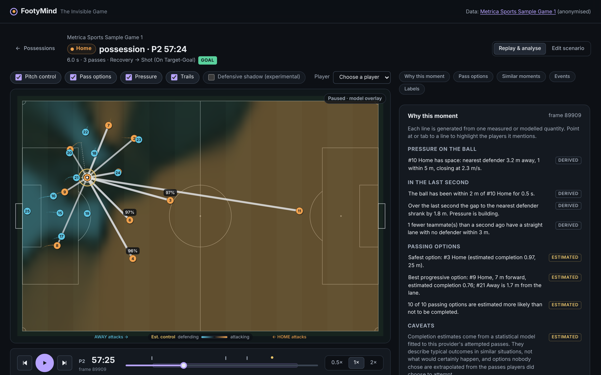
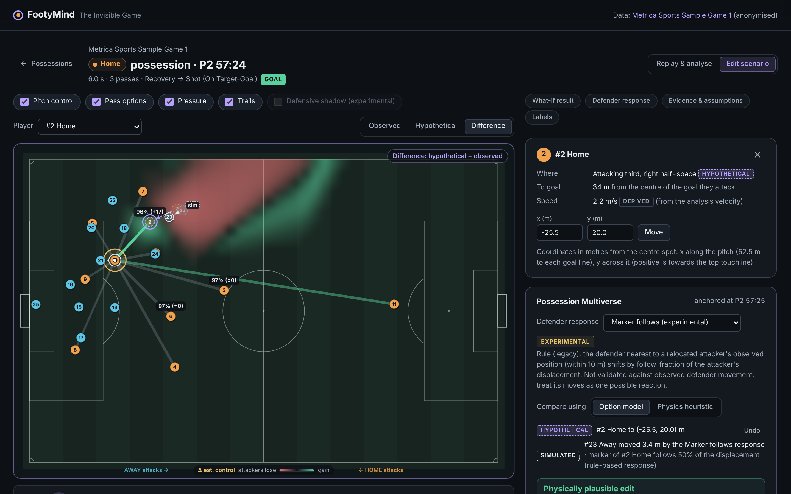
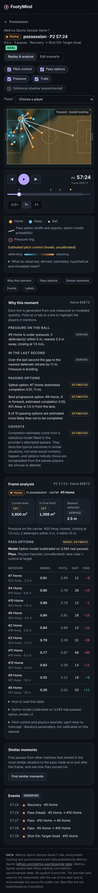
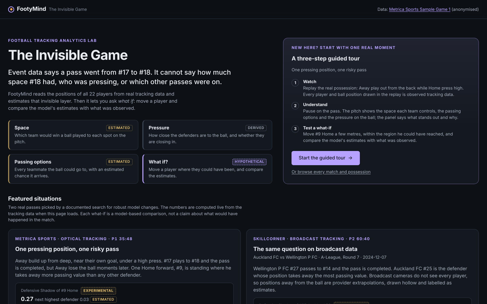
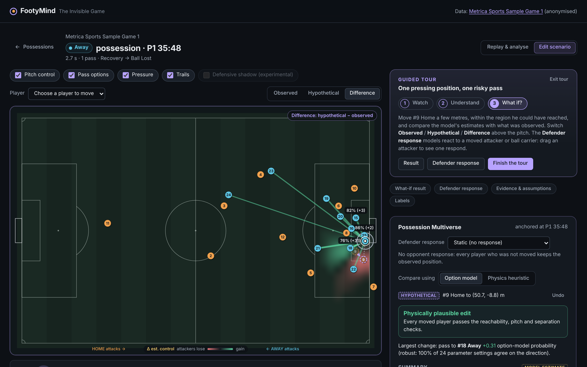

# FootyMind web lab

The browser front end for FootyMind 2.0 ("The Invisible Game"). It replays real
tracking data, overlays the spatial model's estimates on a paused frame, and lets
you edit a frame to compare observed and hypothetical model outputs.



| Scenario, difference view | Phone width |
| --- | --- |
|  |  |





Data: Metrica Sports sample games (real, anonymised tracking at 25 Hz with
synchronised events), https://github.com/metrica-sports/sample-data. The app
shows the attribution returned by the API on every page.

## Run

```bash
# 1. backend (from the repository root)
uv sync
uv run footymind download && uv run footymind ingest   # first time only
uv run footymind serve                                  # API on :8000

# 2. frontend dev server (proxies /api to :8000)
cd web
npm install
npm run dev            # http://localhost:5173
```

Production: `npm run build` writes `web/dist`, which FastAPI mounts at `/` when it
exists, so `http://127.0.0.1:8000/` serves the app and API from one origin.
Set `FOOTYMIND_API` to proxy the dev server to a different backend.

## Check

```bash
npm run typecheck   # tsc, strict
npm run lint        # eslint, zero warnings
npm test            # vitest unit and component tests (synthetic fixtures)
npm run build
npm run e2e         # Playwright against the real backend and real data
npm run screenshots # regenerate screenshots/ at 2x (SHOT_DPR, SHOT_DIR override)
```

`npm run e2e` starts the backend (`uv run uvicorn ...` from the repository root)
and the Vite server unless they are already running, so export
`FOOTYMIND_DATA_DIR` first. Set `E2E_BASE_URL=http://127.0.0.1:8765` to test the
production build served by FastAPI instead. With a preinstalled Chromium the
config falls back to `/opt/pw-browsers/chromium`, or you can set `PW_CHROMIUM`.

## Using the lab

0. **New here?** Start the guided tour from the landing page. It opens a featured
   situation and walks through three steps: *Watch* the observed possession,
   *Understand* the paused decision (pitch control, pressure, pass options, "Why
   this moment", similar moments), and *What if?* (the curated move applied, with
   the observed, hypothetical and difference views and the defender-response
   selector). The featured cards compute their numbers live from the API.
1. Or pick any match and open a possession (team, period, match clock, duration,
   passes, and shot or goal badges). The list shows 20 rows; "Show all" expands it.
2. Replay it: <kbd>Space</kbd> plays or pauses, <kbd>←</kbd>/<kbd>→</kbd> step a frame
   (<kbd>Shift</kbd> steps 1 s), 0.5×/1×/2× speed, and the timeline has event
   markers. Trails show the last 1.5 s.
3. Pause on any frame to see estimated pitch control (a compact colour key sits in
   the pitch margin), pass options (line width and opacity encode the option-model
   probability) and pressure on the carrier. The side table ranks the options and
   also serves as the text alternative; "How to read this table" explains each
   column. Jump links at the top of the analysis column reach "Why this moment",
   pass options, similar moments, events and the labels key.
4. **Edit scenario**: drag up to four players. While you drag, the dashed circle
   shows where the player could have reached (7 m/s from the observed position
   1.5 s earlier). On drop, the backend re-runs the model. You can choose the
   defender response, compare by the option model or the physics heuristic, switch
   between observed, hypothetical and difference views, and read the deltas with
   their 10–90% ensemble ranges, sign agreement and the evidence and assumptions.
   The response models react to a moved attacker or ball carrier; when only
   defenders are moved, the panel says so. **Reset to observed** returns to the data.
5. Click a player (or use the Player menu) to see where they are in football terms
   (third, channel, distance to goal), their speed and the provenance of each value.
   Exact pitch coordinates are in a disclosure. In edit mode the player card also
   offers a keyboard-accessible move form.

## Provenance on screen

| Label | Pitch | Text |
| --- | --- | --- |
| observed | solid disc and ball | solid grey badge |
| derived | n/a | outlined badge |
| estimated | translucent heatmap and pass lines, "model" labels; hollow dashed players and ball off camera (broadcast), the ball tagged "est." | dotted amber badge |
| hypothetical (you moved) | translucent disc, dashed violet ring, ghost and dashed arrow | dashed violet badge |
| simulated (rule response) | translucent disc, dotted white ring, dotted arrow | dotted white badge |

The legend's "What do observed, derived, estimated, hypothetical and simulated
mean?" disclosure and the landing page's key explain all five labels.
Pitch control is always labelled "Estimated pitch control (model, uncalibrated)".
Pass probabilities name their model: the calibrated option model is primary, and
the physics heuristic is shown as uncalibrated. API warnings appear verbatim.

## Architecture

```
src/api/        types.ts mirrors src/footymind/api/schemas.py; parse.ts validates
                payloads and turns the replay into typed arrays (NaN = not observed);
                client.ts is the typed fetch client with readable FastAPI errors
src/lib/        coords (metres <-> canvas, y flip), interp (sub-frame interpolation
                that never draws an unobserved position), playback (rAF clock),
                formatting, routing, model labels
src/render/     PitchRenderer: imperative Canvas 2D, HiDPI, cached markings and
                rasters; theme colours read from the CSS tokens
src/components/ React UI; the Lab orchestrates playback, analysis and scenarios
src/styles/     tokens.css (design tokens as CSS variables) and app.css
e2e/            Playwright flow test and screenshot generator
```

React never re-renders per animation frame. The playback clock writes `t` into
the renderer and updates the clock and scrubber DOM nodes directly. Analysis is
fetched only when paused, debounced while scrubbing, and cached per frame.
